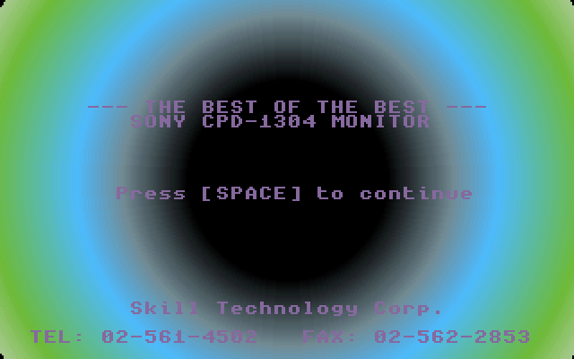
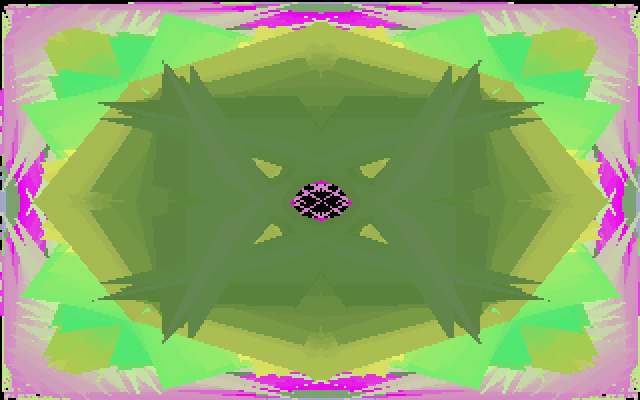
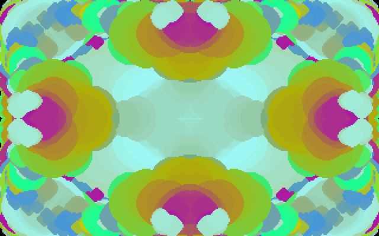

# Kaleidoscope

A cross-platform screen saver built with **Qt 6 Widgets (C++)**, running on **Windows, macOS and Linux**.

It is a faithful port of the 1995 DOS demo shipped with the **SONY CPD-1304** monitor by *Skill Technology Corp.* — a VGA mode 13h kaleidoscope of bouncing, rotating shapes over a continuously cycling 256-colour palette.

> The original program was recovered by reverse-engineering the LZEXE-packed `SONY.EXE`. The emulated VGA core (framebuffer, DAC registers, palette engine, RNG and all drawing primitives) is transcribed instruction-for-instruction, so the screensaver reproduces the original's motion, colours and effect transitions rather than merely imitating them.

---

## Screenshots

| Intro (original behaviour) | Main kaleidoscope effect | Alternate effect |
|---|---|---|
|  |  |  |

The screensaver skips the intro and starts directly on the main kaleidoscope effect, then randomly transitions between effects exactly like the DOS original. These frames were rendered from the emulation core by [tools/frame_dump.cpp](tools/frame_dump.cpp), which drives `SonyDemo` headlessly — the same code path the screen saver uses.

---

## Features

- **Authentic emulation** — 320×200 indexed framebuffer, 6-bit VGA DAC, hardware-style palette shifting and the original 16-bit LFSR random generator
- **Nearest-neighbour scaling** — the pixel-art look is preserved while filling any screen resolution
- **True-to-original pacing** — the demo advances on a wall-clock accumulator calibrated to the DOS vertical-blank rate (70 Hz), so speed does not drift with the host timer
- **Animated transitions** — the original's star, curtain, diagonal-wipe and noise variants run between effects
- **Interactive** — the original's keyboard controls are preserved (see below)
- **Portable** — one codebase, three platforms, no platform-specific rendering code

---

## Download & Install

### Build from source

Requirements:

- CMake ≥ 3.19
- A C++17 compiler
- Qt 6.5 or newer (`Core` and `Widgets`)

```bash
cmake -B build -DCMAKE_PREFIX_PATH=/path/to/qt6
cmake --build build -j
```

#### Windows

The build produces `Kaleidoscope.scr`. Right-click it and choose **Install** (or copy it to `C:\Windows\System32`), then select *Kaleidoscope* in **Settings → Personalisation → Lock screen → Screen saver**.

#### macOS

The build produces `Kaleidoscope.app`. Install it with:

```bash
cmake --install build
```

which copies the bundle to `~/Library/Screen Savers/`. Select it in **System Settings → Screen Saver**.

#### Linux

```bash
cmake --install build
```

This installs the binary to `bin/` and a `kaleidoscope.desktop` entry to `share/applications/`, making it available to XScreenSaver, `gnome-screensaver` and KDE's screen-locker.

---

## Usage

**As a screen saver** — launching with the standard screen-saver flags makes it go fullscreen and exit on keyboard or mouse activity:

```bash
Kaleidoscope -s          # macOS / Linux
Kaleidoscope.scr /s      # Windows
```

**As a windowed demo** — run with no arguments to open it in a normal window:

```bash
./build/Kaleidoscope.app/Contents/MacOS/Kaleidoscope
```

### Keyboard controls

These are the controls of the original DOS program and they all still work. Press **Esc** to quit.

| Key | Action |
|-----|--------|
| `Space` | Switch to the next (random) effect |
| `c` | Toggle colour cycling — freezes the palette rotation |
| `d` | Toggle drawing — freezes the shapes, palette keeps cycling |
| `a` | Toggle automatic effect switching |
| `8` | Turn rotation on |
| `4` | Turn rotation off |
| `w` | Toggle the animated transition variants |
| `Esc` | Quit |

Moving the mouse or clicking also exits, as users expect from a screen saver.

### Command-line options

The original's switches are preserved:

| Option | Meaning |
|--------|---------|
| `/O n` | Start on effect *n* (1–4) |
| `/S n` | Palette-write chunk count (1–9), controls the animation speed |
| `/W` | Disable random transition variants |
| `/4` | Disable rotation |
| `/A` | Enable auto-switching |
| `/P n` | Auto-switch probability |
| `/T n` | Quit after *n* timer ticks |

Example — start on effect 2 with slower palette cycling:

```bash
./build/Kaleidoscope.app/Contents/MacOS/Kaleidoscope /O2 /S2
```

---

## Project layout

| File | Purpose |
|------|---------|
| [sony_core.h](sony_core.h) / [sony_core.cpp](sony_core.cpp) | Portable, dependency-free emulation of the DOS demo — framebuffer, palette engine, effects, variants and RNG |
| [font8x8.h](font8x8.h) | IBM CGA/BIOS 8×8 bitmap font used by the intro screen |
| [screensaverwidget.h](screensaverwidget.h) / [screensaverwidget.cpp](screensaverwidget.cpp) | Qt Widget that blits the VGA framebuffer to screen and drives the demo state machine |
| [main.cpp](main.cpp) | Entry point; parses the screen-saver protocol flags and creates the fullscreen window |
| [CMakeLists.txt](CMakeLists.txt) | Cross-platform build — `.scr` on Windows, `.app` bundle on macOS, ELF + desktop entry on Linux |
| [Info.plist.in](Info.plist.in) | macOS bundle metadata template |
| [kaleidoscope.desktop](kaleidoscope.desktop) | Linux XDG screen-saver registration |
| [tools/frame_dump.cpp](tools/frame_dump.cpp) | Headless harness that renders frames to PPM — produces the screenshots above and verifies the core without a GUI |

### Architecture

The emulation core knows nothing about Qt or any operating system — it exposes a framebuffer, a set of DAC registers and a small state machine:

```
┌──────────────────────┐        ┌───────────────────────┐
│      SonyDemo        │        │  ScreensaverWidget    │
│  (portable C++ core) │        │      (Qt Widget)      │
├──────────────────────┤        ├───────────────────────┤
│ framebuffer()   ─────┼───────▶│ indexed → RGB32       │
│ dac_regs()      ─────┼───────▶│ nearest-neighbour     │
│                      │        │ scale + draw          │
│ step() / key()  ◀────┼────────│ timer + key events    │
│ phase() / quit()     │        │                       │
└──────────────────────┘        └───────────────────────┘
```

`ScreensaverWidget::tick()` converts the 320×200 8-bit framebuffer to `QImage::Format_RGB32` every frame using the DAC palette (6-bit → 8-bit via `(v << 2) | (v >> 4)`), then scales it with `Qt::FastTransformation` to preserve hard pixel edges.

---

## Notes on fidelity

A few deliberate choices were made where a literal transcription would have produced a poor screen saver:

- **The intro is skipped** when launched as a screen saver. The original intro waits for a key press; a screen saver must never wait for input. It is still present in the core (`intro_begin()` / `intro_frame()`).
- **Keys are applied immediately** rather than only at the original's keyboard poll point. The DOS program only read the keyboard every `loop_count_` frames — up to ~63 frames, which is over three seconds. The poll point is still honoured for the timeout and auto-switch logic.
- **The framebuffer is stretched to fill the screen** rather than letterboxed, trading the exact 4:3 aspect ratio for a screen saver that uses the whole display. Nearest-neighbour scaling keeps the chunky VGA look.
- **Two byte-level bugs in the original** are preserved in the transcribed primitives where they affect output character: the `|dy|` initialisation error in y-major `draw_line` and the off-by-one radius shift in `fill_circle`. Both are documented in comments at the relevant lines.

---

## License

Released for preservation and educational purposes. The original demo and the SONY CPD-1304 name are the property of their respective owners; this is an independent reimplementation.